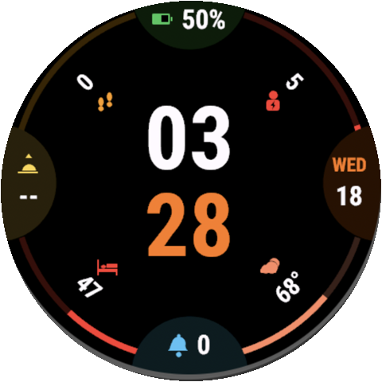
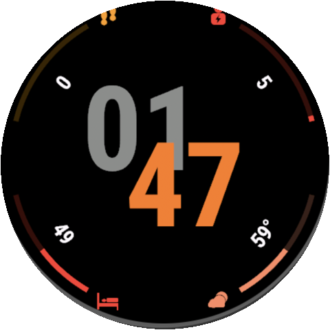
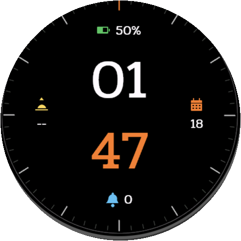
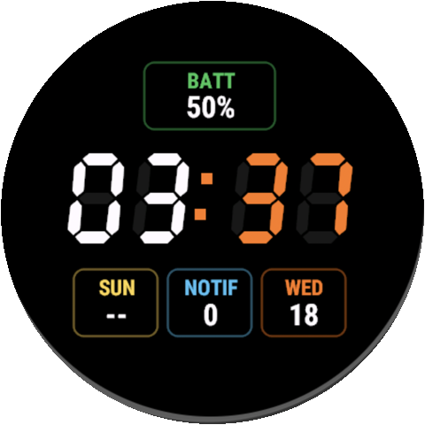
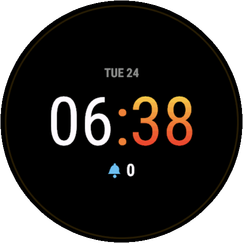
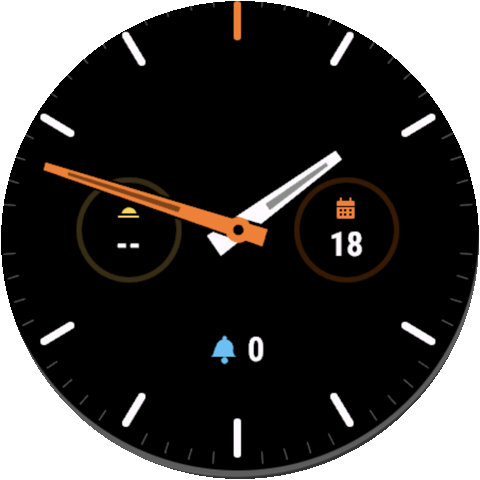

# Gokul Face — personal Connect IQ watch face (Forerunner 970)


Configurable, crash-safe, AMOLED-aware watch face. Sideloaded, not store-published.

## Styles (Customize → Style)

<table>
<tr>
<td align="center"><br><b>Classic</b></td>
<td align="center"><br><b>Overlap</b></td>
<td align="center"><br><b>Serif</b></td>
</tr>
<tr>
<td align="center"><br><b>HUD</b></td>
<td align="center"><br><b>Minimal</b></td>
<td align="center"><br><b>Analog</b></td>
</tr>
</table>

Screenshots from the Connect IQ simulator (Forerunner 970) with its sample data.

| Style | Look | Slots used |
|---|---|---|
| Classic | Stacked Roboto Condensed Bold time; 4 edge tabs (filled half-circles) joined by 4 arc gauges into one border; arc icons sit inside their values | all 8 |
| Overlap | Poster-size digits: dim hours behind, bright minutes in front | the 4 arcs |
| Serif | Pridi serif numerals on a dial: hairline ring, minute ticks, hour marks | the 4 pods, as text |
| HUD | Seven-segment time, labelled outlined cells (1 above, 3 below) | the 4 pods |
| Minimal | Large one-line time, thin progress ring round the bezel, date + one field | bottom pod, top-left arc (ring) |
| Analog | Chronograph: sub-dials at 3 and 9, field at 6, bar markers, bold hands | left, right, bottom pods |

Every style has its own always-on view; Minimal's keeps its data line.
Arcs fill upward: top arcs toward 12, bottom arcs from 6 toward 9/3. Edges are anti-aliased.
Classic's arcs run tab to tab; Overlap keeps shorter arcs with icons at their ends.

## Fields (any slot, 28 + None)
| Group | Fields (icon) |
|---|---|
| Health | Heart rate (heart) · Body Battery (person with bolt) · Stress (disc with zigzag) · Sleep score (bed) · Pulse Ox (drop with bubbles) · Respiration (lungs) · Recovery (clock with countdown arrow) · VO2 max ("VO2" badge) |
| Activity | Steps (footprints, full count e.g. 12,345) · Calories (flame, full count) · Floors (stairs) · Intensity min/wk (stopwatch with bolt) · Vigorous min/wk (sprinter with speed lines) · Weekly run (running shoe over week dots) |
| Watch | Battery (fills to level) · Notifications (bell) · Date (calendar) · Next calendar event (calendar with event) |
| Weather / outdoor | Temperature (live condition icon: clear, partly cloudy, cloudy, rain, snow, storm, fog; moon at night) · Feels like · Wind (gusts, value like "12 NE") · UV index · Humidity · Rain chance · Next sun event · Sunrise · Sunset · Altitude |

Icons are solid glyphs drawn in code, so they take any colour. Values too wide for a pod or cell
drop to a smaller font instead of overflowing.

## Customize (on the watch)
Style · Theme · Time size · Hours / Minutes / Accent colour (17 colours or "Theme", with swatches) ·
Field colours (per field / accent only) · Dynamic colours on/off · each of the 8 slots.
Every item opens a picker list; fields are grouped health / activity / watch / weather.

## Long-press
Touch and hold any field to open the related Garmin app (sleep, Body Battery, weather, ...).

## Themes and colour
Night, Glacier, Moss, Ember, Mono, Paper (light), Neon, Midnight. Each field has its own colour
(heart rate rose, sleep violet, Body Battery blue...), with tracks and frames faintly tinted to match. Battery, Body Battery, stress, heart rate,
recovery, sleep score, Pulse Ox, UV, rain and temperature change colour with their value
(deeper shades on light themes).

## Code map
| File | Role |
|---|---|
| `FaceView.mc` | Hands drawing to the active style; anti-aliasing; crash fallback |
| `Layout.mc` | Slot positions, shared by drawing and long-press hit-testing |
| `FaceDelegate.mc` | Long-press → open the field's Garmin app |
| `Style*.mc` | One file per style (Classic, Overlap, Serif, HUD, Minimal, Analog) |
| `Gauge.mc` / `Pod.mc` / `Dial.mc` / `Segments.mc` | Arc gauges, pods, dial ticks, seven-segment digits |
| `Fields.mc` | Field catalogue: ids, names, one read per field, long-press target |
| `FieldStyle.mc` | Text, gauge fill and value-driven colour per field |
| `Sensors.mc` / `Complic.mc` / `Sun.mc` / `WeatherData.mc` | Data sources: sensors, Garmin complications (sleep, VO2 max...), weather |
| `Icons.mc` / `Glyphs*.mc` | Field → icon; solid glyphs drawn from shapes, so they recolour freely |
| `Theme.mc` / `Palette.mc` / `Fonts.mc` / `TimeSize.mc` | Themes, picker colours, fonts, time sizes |
| `Settings.mc` / `Options.mc` / `SettingsMenu.mc` | Stored settings, their choices, the picker menus |
| `LowPower.mc` | Shared always-on helpers |
| `tools/mtp-install.c` | `make install` helper: copies the build to the watch over MTP |

## One-time setup
1. Download the **Connect IQ SDK Manager** from https://developer.garmin.com/connect-iq/sdk/
   and sign in with your Garmin account.
2. In the SDK Manager, install the latest SDK, then under **Devices** download **Forerunner 970**.
3. In VS Code, install the **Monkey C** extension (Garmin). Run
   `Monkey C: Verify Installation` and point it at `keys/developer_key.der`.

## Build and simulate
```
make run          # builds bin/GokulFace.prg and opens it in the simulator
```
(Start the simulator first with `make sim` if `monkeydo` can't connect.)

## Put it on the watch (sideload)
One-time: `brew install libmtp`, and on the watch set **System → USB Mode → MTP**.

```
make install      # build, copy to GARMIN/Apps (replacing the old copy), verify size
```
Then unplug; on the watch: hold UP → Watch Face → **Gokul Face**.

If it says "No watch found":
- **Quit Chrome** — it keeps Garmin devices open over WebUSB, which also flips the watch back
  to Garmin mode (closing tabs is not enough).
- Close OpenMTP / Garmin Express.
- Plug straight into the Mac (no hub), re-seat the clip; the watch should show it is connected.

Customise from the watch-face menu → **Customize**. Keep `keys/` private and backed up: the same
key must sign every rebuild.
